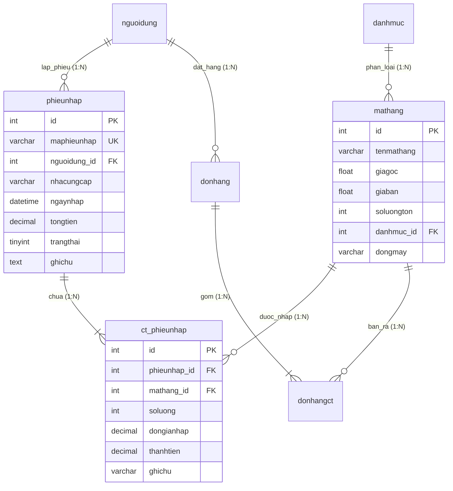
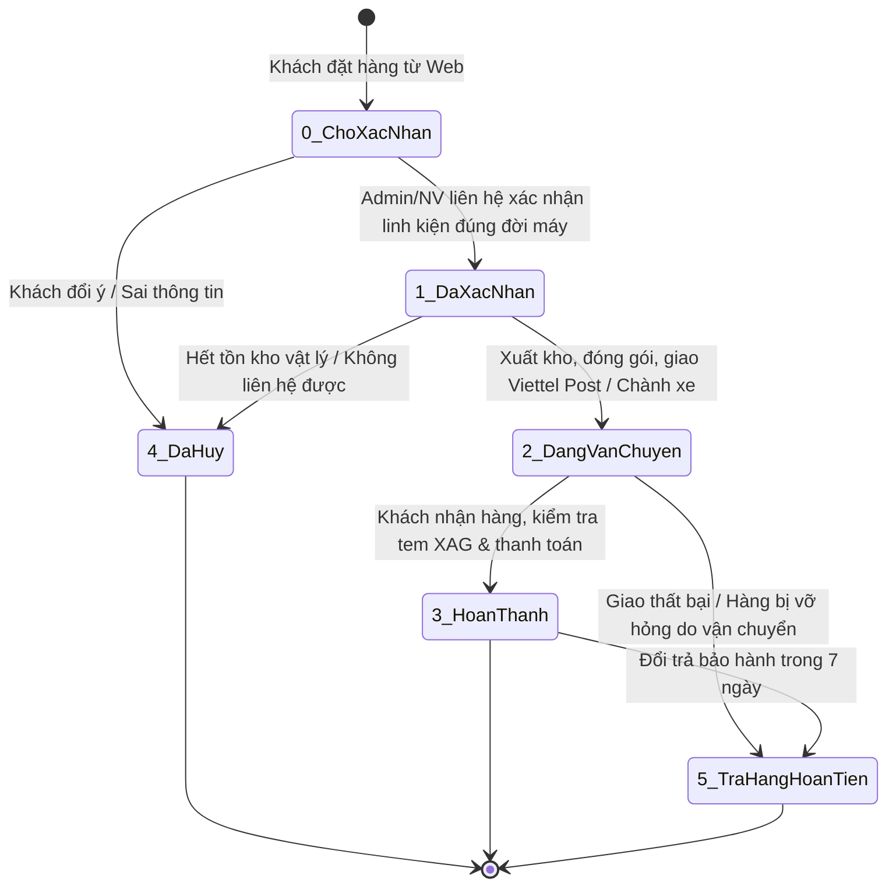

# BÁO CÁO KHẢO SÁT & PHÂN TÍCH KHOẢNG TRỐNG CƠ SỞ DỮ LIỆU
## (DATABASE & MODEL GAP ANALYSIS REPORT)
**Dự án:** Hệ thống Thương mại Điện tử Phụ tùng & Linh kiện Drone Nông nghiệp XAG (XAG Store)  
**Vai trò:** Kiến trúc sư Hệ thống & Kỹ sư CSDL (Database Architect)  
**Tài liệu:** Giai đoạn 1 – Khảo sát CSDL & Model  
**Phiên bản:** 1.0.0 | **Ngày lập:** 21/11/2026  

---

## MỤC LỤC
1. [Tổng quan Khảo sát Schema CSDL Hiện Hữu](#1-tổng-quan-khảo-sát-schema-csdl-hiện-hữu)
2. [Bảng Tóm tắt Cấu trúc CSDL Chi tiết (6 Bảng Hiện Có)](#2-bảng-tóm-tắt-cấu-trúc-csdl-chi-tiết-6-bảng-hiện-có)
3. [Đối chiếu Tính Đồng nhất Schema CSDL và 9 Class Model](#3-đối-chiếu-tính-đồng-nhất-schema-csdl-và-9-class-model)
4. [Thiết kế Hệ thống Quản lý Kho Hàng Chuẩn 3NF](#4-thiết-kế-hệ-thống-quản-lý-kho-hàng-chuẩn-3nf)
5. [Chuẩn hóa Vòng đời Đơn hàng & Dữ liệu Cũ](#5-chuẩn-hóa-vòng-đời-đơn-hàng--dữ-liệu-cũ)
6. [Khuyến nghị Kiến trúc & Lộ trình Kỹ thuật Triển khai Giai đoạn 2](#6-khuyến-nghị-kiến-trúc--lộ-trình-kỹ-thuật-triển-khai-giai-đoạn-2)

---

## 1. TỔNG QUAN KHẢO SÁT SCHEMA CSDL HIỆN HỮU

### 1.1. Hiện trạng các nguồn dữ liệu SQL
Hệ thống hiện tại tồn tại 2 file kịch bản SQL trong thư mục `data/`:
- **`data/shop.sql`**: Là cơ sở dữ liệu mẫu ban đầu (bán văn phòng phẩm / sách vở), encoding `utf8_unicode_ci`. Bảng danh mục và sản phẩm là đồ dùng văn phòng, cấu trúc bảng `nguoidung` dùng `sodienthoai varchar(10)` và `email varchar(50)`.
- **`data/xag_store.sql`**: Là cơ sở dữ liệu chính thức hiện tại của hệ sinh thái Drone nông nghiệp XAG, sử dụng bảng mã chuẩn `utf8mb4_unicode_ci` (hỗ trợ đầy đủ ký tự tiếng Việt có dấu, emoji và chuỗi kỹ thuật đặc thù).

### 1.2. So sánh và kết luận lựa chọn nguồn dữ liệu chuẩn
| Đặc điểm | `data/shop.sql` (Cũ) | `data/xag_store.sql` (Chuẩn hiện hành) |
|---|---|---|
| **Tên Database** | `shop` | `xag_store` |
| **Charset / Collate** | `utf8` / `utf8_unicode_ci` | `utf8mb4` / `utf8mb4_unicode_ci` |
| **Bảng danh mục (`danhmuc`)** | 4 danh mục văn phòng phẩm | 7 danh mục linh kiện Drone chuyên sâu (Motor, Cánh quạt, Pin BMS, Bơm, Vòi phun ly tâm, Mạch FC/ESC, Khung sườn) |
| **Bảng mặt hàng (`mathang`)** | 21 sản phẩm máy tính, giấy | 21 linh kiện Drone XAG thực tế; **đã có cột `dongmay`** (P100, P100 Pro, P40, V40, R150) |
| **Bảng địa chỉ (`diachi`)** | Ràng buộc `ON UPDATE CASCADE` | Ràng buộc chặt chẽ hơn: `ON UPDATE CASCADE ON DELETE CASCADE` |
| **Bảng đơn hàng (`donhang`)** | `diachi_id` không có `ON DELETE` | `diachi_id` có `ON UPDATE CASCADE ON DELETE SET NULL` |

> [!IMPORTANT]
> **Kết luận khảo sát:** Toàn bộ quá trình nâng cấp hệ thống Quản trị Admin bắt buộc phải kế thừa và lấy **`data/xag_store.sql`** làm cơ sở dữ liệu chuẩn duy nhất. Tuyệt đối không sử dụng `data/shop.sql`.

---

## 2. BẢNG TÓM TẮT CẤU TRÚC CSDL CHI TIẾT (6 BẢNG HIỆN CÓ)

Dưới đây là đặc tả chi tiết của 6 bảng dữ liệu hiện có trong `data/xag_store.sql`:

### 2.1. Bảng `danhmuc` (Danh mục linh kiện Drone)
- **Engine:** InnoDB | **Collate:** utf8mb4_unicode_ci
- **Khóa chính (PK):** `id` (INT, AUTO_INCREMENT)
- **Khóa ngoại (FK):** Không có

| Tên Cột | Kiểu Dữ Liệu | Nullable | Mặc Định | Ràng Buộc / Mô Tả Nghiệp Vụ |
|---|---|---|---|---|
| `id` | INT(11) | NO | AUTO_INCREMENT | Khóa chính (PK), định danh duy nhất danh mục linh kiện |
| `tendanhmuc` | VARCHAR(100) | NO | *None* | Tên nhóm linh kiện Drone (VD: Động cơ, Cánh quạt, Pin thông minh...) |

---

### 2.2. Bảng `nguoidung` (Tài khoản người dùng: Admin, Kỹ thuật viên, Khách hàng)
- **Engine:** InnoDB | **Collate:** utf8mb4_unicode_ci
- **Khóa chính (PK):** `id` (INT, AUTO_INCREMENT)
- **Chỉ mục duy nhất (Unique Index):** `email` (`email`)

| Tên Cột | Kiểu Dữ Liệu | Nullable | Mặc Định | Ràng Buộc / Mô Tả Nghiệp Vụ |
|---|---|---|---|---|
| `id` | INT(11) | NO | AUTO_INCREMENT | Khóa chính (PK) |
| `email` | VARCHAR(100) | NO | *None* | Email đăng nhập, định danh tài khoản duy nhất (UNIQUE) |
| `sodienthoai` | VARCHAR(20) | NO | *None* | Số điện thoại liên hệ nhận hàng / hỗ trợ kỹ thuật |
| `matkhau` | VARCHAR(255) | NO | *None* | Mật khẩu tài khoản (hiện lưu dạng chuỗi băm MD5 32 ký tự) |
| `hoten` | VARCHAR(255) | NO | *None* | Họ và tên đầy đủ của người dùng / phi công Drone |
| `loai` | TINYINT(4) | NO | 3 | Phân quyền: `1`: Quản trị viên (Admin), `2`: Kỹ thuật viên/Nhân viên, `3`: Khách hàng/Hợp tác xã |
| `trangthai` | TINYINT(4) | NO | 1 | Trạng thái hoạt động: `1`: Kích hoạt (Hoạt động), `0`: Bị khóa |
| `hinhanh` | VARCHAR(255) | YES | NULL | Đường dẫn ảnh đại diện (avatar) của tài khoản |

---

### 2.3. Bảng `mathang` (Linh kiện, phụ tùng máy bay Drone XAG)
- **Engine:** InnoDB | **Collate:** utf8mb4_unicode_ci
- **Khóa chính (PK):** `id` (INT, AUTO_INCREMENT)
- **Khóa ngoại (FK):** `danhmuc_id` tham chiếu `danhmuc(id)` (`ON UPDATE CASCADE`)

| Tên Cột | Kiểu Dữ Liệu | Nullable | Mặc Định | Ràng Buộc / Mô Tả Nghiệp Vụ |
|---|---|---|---|---|
| `id` | INT(11) | NO | AUTO_INCREMENT | Khóa chính (PK) |
| `tenmathang` | VARCHAR(255) | NO | *None* | Tên đầy đủ linh kiện, phụ tùng XAG |
| `mota` | TEXT | YES | NULL | Mô tả chi tiết thông số kỹ thuật (HTML formatting) |
| `giagoc` | FLOAT | NO | 0 | Giá vốn nhập kho hoặc giá gốc của linh kiện (VNĐ) |
| `giaban` | FLOAT | NO | 0 | Giá niêm yết bán lẻ đến tay khách hàng (VNĐ) |
| `soluongton` | INT(11) | NO | 0 | Số lượng linh kiện thực tế còn trong kho vật lý |
| `hinhanh` | VARCHAR(255) | YES | NULL | Đường dẫn ảnh minh họa sản phẩm |
| `danhmuc_id` | INT(11) | NO | *None* | Khóa ngoại (FK) liên kết bảng `danhmuc(id)` |
| `dongmay` | VARCHAR(100) | YES | NULL | Dòng Drone tương thích: XAG P100, P100 Pro, P40, V40, R150 |
| `luotxem` | INT(11) | NO | 0 | Số lượt người dùng xem chi tiết sản phẩm |
| `luotmua` | INT(11) | NO | 0 | Số lượt sản phẩm đã được đặt mua thành công |

---

### 2.4. Bảng `diachi` (Sổ địa chỉ giao hàng của khách hàng)
- **Engine:** InnoDB | **Collate:** utf8mb4_unicode_ci
- **Khóa chính (PK):** `id` (INT, AUTO_INCREMENT)
- **Khóa ngoại (FK):** `nguoidung_id` tham chiếu `nguoidung(id)` (`ON UPDATE CASCADE ON DELETE CASCADE`)

| Tên Cột | Kiểu Dữ Liệu | Nullable | Mặc Định | Ràng Buộc / Mô Tả Nghiệp Vụ |
|---|---|---|---|---|
| `id` | INT(11) | NO | AUTO_INCREMENT | Khóa chính (PK) |
| `nguoidung_id` | INT(11) | NO | *None* | Khóa ngoại (FK) liên kết tới tài khoản khách hàng |
| `diachi` | VARCHAR(255) | NO | *None* | Địa chỉ chi tiết (Ấp/Thôn, Xã/Phường, Huyện, Tỉnh hoặc Chành xe) |
| `macdinh` | TINYINT(4) | NO | 1 | Đánh dấu địa chỉ giao hàng mặc định (`1`: Mặc định, `0`: Phụ) |

---

### 2.5. Bảng `donhang` (Đơn đặt hàng linh kiện Drone)
- **Engine:** InnoDB | **Collate:** utf8mb4_unicode_ci
- **Khóa chính (PK):** `id` (INT, AUTO_INCREMENT)
- **Khóa ngoại (FK):** 
  - `nguoidung_id` tham chiếu `nguoidung(id)` (`ON UPDATE CASCADE`)
  - `diachi_id` tham chiếu `diachi(id)` (`ON UPDATE CASCADE ON DELETE SET NULL`)

| Tên Cột | Kiểu Dữ Liệu | Nullable | Mặc Định | Ràng Buộc / Mô Tả Nghiệp Vụ |
|---|---|---|---|---|
| `id` | INT(11) | NO | AUTO_INCREMENT | Khóa chính (PK) mã đơn hàng |
| `nguoidung_id` | INT(11) | NO | *None* | Khóa ngoại (FK) tài khoản người đặt hàng |
| `diachi_id` | INT(11) | YES | NULL | Khóa ngoại (FK) địa chỉ giao hàng nhận đơn |
| `ngay` | DATETIME | NO | CURRENT_TIMESTAMP | Thời điểm khách đặt đơn hàng |
| `tongtien` | FLOAT | NO | 0 | Tổng giá trị đơn hàng (VNĐ) |
| `ghichu` | VARCHAR(255) | YES | NULL | Ghi chú giao hàng, yêu cầu đóng bọc bến xe, kiểm tra linh kiện |
| *(trangthai)* | *TINYINT(4)* | *NO* | *0* | **Khoảng trống CSDL:** CSDL gốc `data/xag_store.sql` **CHƯA CÓ** cột này! Cần migration bổ sung. |

---

### 2.6. Bảng `donhangct` (Chi tiết mặt hàng trong đơn hàng)
- **Engine:** InnoDB | **Collate:** utf8mb4_unicode_ci
- **Khóa chính (PK):** `id` (INT, AUTO_INCREMENT)
- **Khóa ngoại (FK):**
  - `donhang_id` tham chiếu `donhang(id)` (`ON UPDATE CASCADE`)
  - `mathang_id` tham chiếu `mathang(id)` (`ON UPDATE CASCADE`)

| Tên Cột | Kiểu Dữ Liệu | Nullable | Mặc Định | Ràng Buộc / Mô Tả Nghiệp Vụ |
|---|---|---|---|---|
| `id` | INT(11) | NO | AUTO_INCREMENT | Khóa chính (PK) |
| `donhang_id` | INT(11) | NO | *None* | Khóa ngoại (FK) tham chiếu đơn hàng cha |
| `mathang_id` | INT(11) | NO | *None* | Khóa ngoại (FK) tham chiếu linh kiện được đặt mua |
| `dongia` | FLOAT | NO | 0 | Đơn giá bán tại thời điểm chốt đơn (VNĐ) |
| `soluong` | INT(11) | NO | 1 | Số lượng đặt mua |
| `thanhtien` | FLOAT | NO | 0 | Thành tiền = `dongia * soluong` |

---

## 3. ĐỐI CHIẾU TÍNH ĐỒNG NHẤT SCHEMA CSDL VÀ 9 CLASS MODEL

Sau khi rà soát từng dòng mã nguồn trong toàn bộ 9 file tại `model/`, phát hiện nhiều điểm sai lệch, lỗi nghiêm trọng và các lỗ hổng cần khắc phục:

### 3.1. Bảng tổng hợp đối chiếu 9 Class Model
```
┌─────────────────────┬───────────────────┬───────────────────┬──────────────────────────────────────────────┐
│ File Model          │ Class PHP         │ Bảng CSDL         │ Tình trạng đồng nhất & Đánh giá rủi ro       │
├─────────────────────┼───────────────────┼───────────────────┼──────────────────────────────────────────────┤
│ model/database.php  │ DATABASE          │ (Hạ tầng PDO)     │ ❌ LỖI FATAL: Phương thức không tồn tại       │
│ model/danhmuc.php   │ DANHMUC           │ danhmuc           │ ⚠️ THIẾU: Ràng buộc FK khi xóa, thiếu đếm SP  │
│ model/mathang.php   │ MATHANG           │ mathang           │ ⚠️ SAI LỆCH: Thuộc tính & Bỏ sót cột dongmay │
│ model/nguoidung.php │ NGUOIDUNG         │ nguoidung         │ 🚨 BẢO MẬT: Băm MD5, thiếu lấy user theo ID  │
│ model/khachhang.php │ KHACHHANG         │ nguoidung         │ ⚠️ BẢO MẬT: Mặc định password = sđt (MD5)    │
│ model/diachi.php    │ DIACHI            │ diachi            │ ⚠️ HẠN CHẾ: Chỉ lấy 1 địa chỉ, thiếu CRUD    │
│ model/donhang.php   │ DONHANG           │ donhang           │ ❌ LỆCH SCHEMA: Thiếu cột trạng thái đơn     │
│ model/donhangct.php │ DONHANGCT         │ donhangct         │ ⚠️ CÚ PHÁP: Implicit join, ORDER BY mập mờ   │
│ model/giohang.php   │ (Procedural func) │ $_SESSION         │ ⚠️ THIẾU: Không kiểm tra tồn kho khi add     │
└─────────────────────┴───────────────────┴───────────────────┴──────────────────────────────────────────────┘
```

---

### 3.2. Chi tiết các sai lệch, lỗi cú pháp và lỗ hổng bảo mật

#### 1. Lỗi Fatal trong `model/database.php`
- **Mã nguồn hiện tại (Dòng 33–53):**
  ```php
  public static function execute_nonquery($sql, $option = array()) {
      self::getDB(); // ❌ Method getDB() KHÔNG HỒ TỒN TẠI trong class!
      if (self::$db != null) {
          ...
      } else {
          ShowError("Lỗi kết nối cơ sở dữ liệu"); // ❌ Hàm ShowError() KHÔNG TỒN TẠI trong PHP!
      }
      self::disconnect(); // ❌ Method disconnect() KHÔNG HỒ TỒN TẠI!
  }
  ```
- **Hậu quả:** Nếu bất kỳ chức năng nào gọi `execute_nonquery()`, ứng dụng sẽ crash ngay lập tức với lỗi `Fatal error: Call to undefined method DATABASE::getDB()`.
- **Thiếu Transaction:** `DATABASE` hiện chỉ tạo một đối tượng PDO cơ bản, không có các wrapper điều khiển `beginTransaction()`, `commit()`, `rollBack()`. Điều này khiến việc lưu đơn hàng nhiều bước hoặc nhập kho không thể rollback khi lỗi.
- **Lỗi `exit()` phá hỏng API:** Trong khối `catch(PDOException $e)` ở hàm `connect()`, code đang gọi `echo "<p>Lỗi kết nối: $error_message</p>"; exit();`. Điều này làm lộ chuỗi kết nối nhạy cảm và phá vỡ cấu trúc Response chuẩn.

#### 2. Sai lệch thuộc tính và bỏ sót cột trong `model/mathang.php`
- **Không đồng nhất tên biến (Dòng 11 vs Dòng 29–30):**
  - Khai báo: `private $danhmucid;`
  - Getter/Setter: lại gọi `$this->danhmuc_id`.
  - Trên PHP 8.2+, việc gán thuộc tính chưa khai báo sẽ gây lỗi `Deprecated: Creation of dynamic property MATHANG::$danhmuc_id is deprecated`.
- **Bỏ quên cột `dongmay`:**
  - Bảng `mathang` trong `data/xag_store.sql` có cột `dongmay varchar(100)`.
  - Tuy nhiên, trong `MATHANG`: Không khai báo `$dongmay`, không có `getdongmay()` / `setdongmay()`.
  - Nghiêm trọng hơn, trong hàm `themmathang()` (dòng 125) và `suamathang()` (dòng 166), câu lệnh SQL `INSERT` và `UPDATE` **hoàn toàn bỏ quên cột `dongmay`**. Khi Admin thêm hoặc cập nhật sản phẩm, dữ liệu dòng máy tương thích (P100, P40...) sẽ bị mất hoặc gán `NULL`.
- **Nguy cơ Race Condition âm kho:**
  - Hàm `capnhatsoluong($id, $soluong)` chỉ thực thi:  
    `UPDATE mathang SET soluongton=soluongton - :soluong WHERE id=:id`  
    mà không có điều kiện `AND soluongton >= :soluong`. Khách hàng có thể đặt hàng vượt tồn kho dẫn đến `soluongton < 0`.

#### 3. Bất đồng nhất cấu trúc Đơn hàng trong `model/donhang.php`
- CSDL `data/xag_store.sql` gốc chưa có cột `trangthai`.
- Class `DONHANG` không có các hàm cần thiết cho Admin:
  - Chưa có `laytatcadonhang()` (chỉ có `laydanhsachdonhangtheokh($id)`).
  - Chưa có `laydonhangtheoid($id)` kèm thông tin khách hàng và địa chỉ.
  - Chưa có `capnhattrangthai($id, $trangthai)` phục vụ chuyển trạng thái đơn.
  - Chưa có các hàm thống kê: Doanh thu theo ngày/tháng/năm, số lượng đơn theo trạng thái.

#### 4. Lỗ hổng bảo mật trong `model/nguoidung.php` & `model/khachhang.php`
- **Sử dụng mã hóa MD5 lỗi thời:** Cả 2 model đều dùng `md5($matkhau)` (ví dụ dòng 36, dòng 93 `model/nguoidung.php`). Thuật toán MD5 không an toàn trước tấn công từ điển (Dictionary Attack) và bảng băm sẵn (Rainbow Table). Cần nâng cấp lên `password_hash($matkhau, PASSWORD_BCRYPT)`.
- **Lỗ hổng mật khẩu mặc định:** Trong `model/khachhang.php` (dòng 11), khi khách vãng lai đặt hàng, mật khẩu tự động được sinh bằng số điện thoại: `md5($sodt)`. Bất kỳ ai biết số điện thoại của khách đều có thể đăng nhập vào tài khoản nếu không áp dụng xác thực bổ sung.

#### 5. Cú pháp truy vấn cổ trong `model/donhangct.php`
- Dòng 31 sử dụng cú pháp kết nối bảng ngầm định (Implicit Join):  
  `SELECT c.*, m.id as mhid, m.tenmathang, m.hinhanh FROM donhangct c, mathang m WHERE c.donhang_id=:id AND c.mathang_id=m.id ORDER BY id DESC`
- Mệnh đề `ORDER BY id DESC` không chỉ rõ bảng (`c.id` hay `m.id`), gây lỗi `Column 'id' in order clause is ambiguous` trên các phiên bản MariaDB/MySQL cấu hình strict mode. Cần viết lại bằng `INNER JOIN` chuẩn ANSI SQL.

---

## 4. THIẾT KẾ HỆ THỐNG QUẢN LÝ KHO HÀNG CHUẨN 3NF

Để phục vụ bài toán quản lý nhập hàng linh kiện Drone XAG (động cơ, pin, bơm, vòi phun, bo mạch FC...), hệ thống được thiết kế bổ sung 2 bảng chuẩn dạng chuẩn 3 (3NF), liên kết toàn vẹn với `nguoidung` và `mathang`.

### 4.1. Sơ đồ Quan hệ Thực thể Kho Hàng (ERD)



### 4.2. Đặc tả kỹ thuật 2 bảng Kho Hàng Mới

#### Bảng `phieunhap` (Chứng từ nhập kho)
- **Tên bảng:** `phieunhap` | **Engine:** InnoDB | **Collate:** utf8mb4_unicode_ci
- **Khóa chính (PK):** `id` (INT, AUTO_INCREMENT)
- **Khóa duy nhất (Unique Key):** `maphieunhap` (VARCHAR(50)) – Đảm bảo mã phiếu nhập không trùng lặp (ví dụ: `PN-20261101-001`).
- **Khóa ngoại (FK):** `nguoidung_id` tham chiếu `nguoidung(id)` với ràng buộc:
  - `ON UPDATE CASCADE`: Khi mã người dùng thay đổi, tự động cập nhật.
  - `ON DELETE RESTRICT`: **Ngăn chặn xóa** người dùng/nhân viên nếu đã lập phiếu nhập kho để đảm bảo tính minh bạch kiểm toán (Audit Trail).

| Tên Cột | Kiểu Dữ Liệu | Null | Mặc Định | Mô Tả & Ý Nghĩa Nghiệp Vụ |
|---|---|---|---|---|
| `id` | INT(11) | NO | AUTO_INCREMENT | Khóa chính tự tăng |
| `maphieunhap` | VARCHAR(50) | NO | *None* | Mã chứng từ kế toán nhập kho duy nhất (UNIQUE) |
| `nguoidung_id` | INT(11) | NO | *None* | FK tham chiếu `nguoidung(id)` (Admin/Thủ kho lập phiếu) |
| `nhacungcap` | VARCHAR(255) | NO | *None* | Nhà phân phối hoặc đối tác sản xuất (VD: XAG Guangzhou) |
| `ngaynhap` | DATETIME | NO | CURRENT_TIMESTAMP | Thời gian thực tế nhập kho vật lý |
| `tongtien` | DECIMAL(15,2) | NO | 0.00 | Tổng giá trị lô hàng nhập kho (VNĐ) |
| `trangthai` | TINYINT(4) | NO | 1 | `1`: Hoàn thành (đã cộng tồn kho), `0`: Đã hủy |
| `ghichu` | TEXT | YES | NULL | Ghi chú số vận đơn, biển số xe giao nhận, chứng từ hải quan |
| `ngaytao` | DATETIME | NO | CURRENT_TIMESTAMP | Thời điểm ghi nhận bản ghi |
| `ngaycapnhat` | DATETIME | NO | CURRENT_TIMESTAMP | Tự động cập nhật khi sửa đổi dữ liệu |

#### Bảng `ct_phieunhap` (Chi tiết linh kiện trong phiếu nhập)
- **Tên bảng:** `ct_phieunhap` | **Engine:** InnoDB | **Collate:** utf8mb4_unicode_ci
- **Khóa chính (PK):** `id` (INT, AUTO_INCREMENT)
- **Khóa ngoại (FK):**
  - `phieunhap_id` tham chiếu `phieunhap(id)`: `ON UPDATE CASCADE ON DELETE CASCADE` (Xóa phiếu nhập thì tự động xóa các dòng chi tiết đi kèm).
  - `mathang_id` tham chiếu `mathang(id)`: `ON UPDATE CASCADE ON DELETE RESTRICT` (Ngăn chặn xóa sản phẩm nếu đã có lịch sử nhập kho).
- **Ràng buộc duy nhất phức hợp (Compound Unique Key):** `UNIQUE (phieunhap_id, mathang_id)` – Chống trùng lặp một linh kiện nhiều lần trong cùng một phiếu nhập (chuẩn hóa 3NF).

| Tên Cột | Kiểu Dữ Liệu | Null | Mặc Định | Mô Tả & Ý Nghĩa Nghiệp Vụ |
|---|---|---|---|---|
| `id` | INT(11) | NO | AUTO_INCREMENT | Khóa chính tự tăng |
| `phieunhap_id` | INT(11) | NO | *None* | FK tham chiếu `phieunhap(id)` |
| `mathang_id` | INT(11) | NO | *None* | FK tham chiếu linh kiện `mathang(id)` |
| `soluong` | INT(11) | NO | 1 | Số lượng kiện hàng nhập kho (> 0) |
| `dongianhap` | DECIMAL(15,2) | NO | 0.00 | Giá vốn nhập kho tại thời điểm lập phiếu |
| `thanhtien` | DECIMAL(15,2) | NO | 0.00 | Thành tiền = `soluong * dongianhap` |
| `ghichu` | VARCHAR(255) | YES | NULL | Mã lô sản xuất (Batch No.), số Serial từng cụm linh kiện |

---

## 5. CHUẨN HÓA VÒNG ĐỜI ĐƠN HÀNG & DỮ LIỆU CŨ

### 5.1. Vấn đề phát hiện
Trong CSDL `xag_store.sql` gốc, bảng `donhang` **chưa hề có cột `trangthai`**. Khi khách hàng đặt đơn từ giao diện `public/checkout.php`, câu lệnh INSERT trong `model/donhang.php` chỉ ghi nhận:
```sql
INSERT INTO donhang(nguoidung_id, diachi_id, tongtien) VALUES(...)
```
Hệ thống quản trị hoàn toàn không có cơ sở để lọc đơn mới, duyệt giao hàng hay thống kê đơn thành công/thất bại.

### 5.2. Ma trận Vòng đời Đơn hàng (Order State Machine)
Đề xuất chuẩn hóa cột `trangthai` thành kiểu số nguyên `TINYINT(4)` với 6 trạng thái nghiệp vụ cụ thể cho linh kiện Drone:



### 5.3. Bảng Quy chuẩn Giá trị Trạng thái Đơn hàng
| Giá trị | Tên Trạng Thái | Badge Giao Diện UI | Hành động Quản trị & Hiệu ứng Kho Hàng |
|:---:|---|---|---|
| **0** | **Chờ xác nhận** | `bg-amber-100 text-amber-800` (Vàng) | Đơn mới phát sinh, giữ chỗ tồn kho tạm thời. Chờ điện thoại xác minh model Drone. |
| **1** | **Đã xác nhận & Chờ đóng gói** | `bg-blue-100 text-blue-800` (Xanh dương) | Kỹ thuật viên kiểm tra seal, tem chống hàng giả XAG, in phiếu xuất kho. |
| **2** | **Đang vận chuyển** | `bg-indigo-100 text-indigo-800` (Chàm) | Hàng đã xuất kho vật lý, cập nhật mã vận đơn bưu cục hoặc tên tài xế chành xe. |
| **3** | **Hoàn thành** | `bg-emerald-100 text-emerald-800` (Xanh lá) | Giao hàng và thu tiền COD thành công; ghi nhận chính thức vào báo cáo doanh thu. |
| **4** | **Đã hủy** | `bg-rose-100 text-rose-800` (Đỏ) | Đơn bị hủy; **tự động hoàn lại số lượng tồn kho** (`soluongton = soluongton + soluong`). |
| **5** | **Trả hàng / Hoàn tiền** | `bg-purple-100 text-purple-800` (Tím) | Nhận lại linh kiện hoàn trả, nhập lại kho phụ phẩm/hàng lỗi để bảo hành. |

### 5.4. Kịch bản Migration an toàn
File `data/update_admin_features.sql` đã được khởi tạo để thực thi an toàn các tác vụ sau:
1. Tự động kiểm tra schema qua `INFORMATION_SCHEMA.COLUMNS` trước khi `ALTER TABLE donhang ADD COLUMN trangthai TINYINT(4) NOT NULL DEFAULT 0`.
2. Tạo chỉ mục tổng hợp `idx_donhang_trangthai_ngay` trên `(trangthai, ngay)` để tăng tốc độ lọc báo cáo từ hàng trăm nghìn đơn hàng.
3. Cập nhật dữ liệu cho 2 đơn hàng mẫu có sẵn:
   - Đơn 1 (26.850.000 đ): Gán `trangthai = 3` (Hoàn thành)
   - Đơn 2 (9.600.000 đ): Gán `trangthai = 2` (Đang vận chuyển)
4. Thêm chỉ mục `idx_mathang_soluongton` để hỗ trợ dashboard cảnh báo linh kiện sắp hết hàng (`soluongton < 5`).

---

## 6. KHUYẾN NGHỊ KIẾN TRÚC & LỘ TRÌNH KỸ THUẬT TRIỂN KHAI GIAI ĐOẠN 2

Để chuẩn bị bước vào **Giai đoạn 2 (Xây dựng Service Layer cho Admin)** theo đúng tiêu chuẩn kiến trúc phần mềm chuyên nghiệp, cần thực hiện các cải tiến hạ tầng sau:

### 6.1. Tái cấu trúc lớp kết nối `DATABASE` & Transaction Manager
Cần thay thế cơ chế in lỗi thô `echo; exit()` bằng mô hình Exception-driven:
```php
// Kiến trúc mong muốn cho Database Driver
class DatabaseService {
    public static function pdo(): PDO;
    public static function beginTransaction(): void;
    public static function commit(): void;
    public static function rollBack(): void;
}
```
Mọi thao tác thay đổi tồn kho (nhập hàng qua `InventoryAdminService` hay duyệt hủy đơn qua `OrderAdminService`) phải được bọc trong `beginTransaction() ... commit()` kèm cơ chế khóa dòng bi quan:
```sql
SELECT soluongton FROM mathang WHERE id = :id FOR UPDATE;
```

### 6.2. Nâng cấp chuẩn băm mật khẩu (Bcrypt)
Thay thế toàn bộ `md5()` bằng hàm chuẩn của PHP:
```php
// Khi tạo mới / đổi mật khẩu:
$hash = password_hash($matkhau, PASSWORD_BCRYPT, ['cost' => 12]);

// Khi kiểm tra đăng nhập:
if (password_verify($matkhau_nhap, $hash_trong_db)) { ... }
```
*Lưu ý tương thích ngược:* Đối với các tài khoản cũ đang lưu mã MD5 (32 ký tự hex), Service Layer sẽ hỗ trợ cơ chế tự động nâng cấp: Nếu chuỗi băm có độ dài 32 ký tự, kiểm tra `md5()`; nếu khớp, tự động re-hash bằng Bcrypt và cập nhật lại vào DB.

### 6.3. Kiến trúc các lớp Service cần xây dựng ở Giai đoạn 2
Tạo thư mục `admin/services/` với 7 Service chuyên trách tách biệt hoàn toàn khỏi Presentation Layer:
1. `DashboardService.php`: Tính toán KPI doanh thu, số đơn chờ duyệt, số sản phẩm chạm ngưỡng tồn kho tối thiểu, dữ liệu vẽ biểu đồ doanh thu 7 ngày/12 tháng.
2. `OrderAdminService.php`: Danh sách đơn có phân trang, bộ lọc đa năng, cập nhật trạng thái đơn hàng kèm trừ/hoàn tồn kho trong Database Transaction.
3. `InventoryAdminService.php`: Tạo phiếu nhập kho linh kiện, cập nhật tự động `soluongton` của sản phẩm XAG, tra cứu lịch sử nhập kho.
4. `ProductAdminService.php`: Quản lý toàn diện mặt hàng (CRUD, upload ảnh an toàn, cập nhật đầy đủ cột `dongmay`, kiểm tra ràng buộc trước khi xóa).
5. `CategoryAdminService.php`: Quản lý danh mục, đếm số sản phẩm trong danh mục, ngăn chặn xóa danh mục đang có sản phẩm.
6. `UserAdminService.php`: Quản lý tài khoản Admin & Kỹ thuật viên, đổi trạng thái khóa/mở, đổi mật khẩu an toàn.
7. `CustomerAdminService.php`: Quản lý khách hàng, xem tổng chi tiêu và lịch sử đơn hàng của từng hợp tác xã/phi công.

---
**Người lập báo cáo:** Database Architect & System Architect  
**Trạng thái bàn giao:** Đã hoàn thành Giai đoạn 1 – Sẵn sàng chuyển giao sang Giai đoạn 2.
